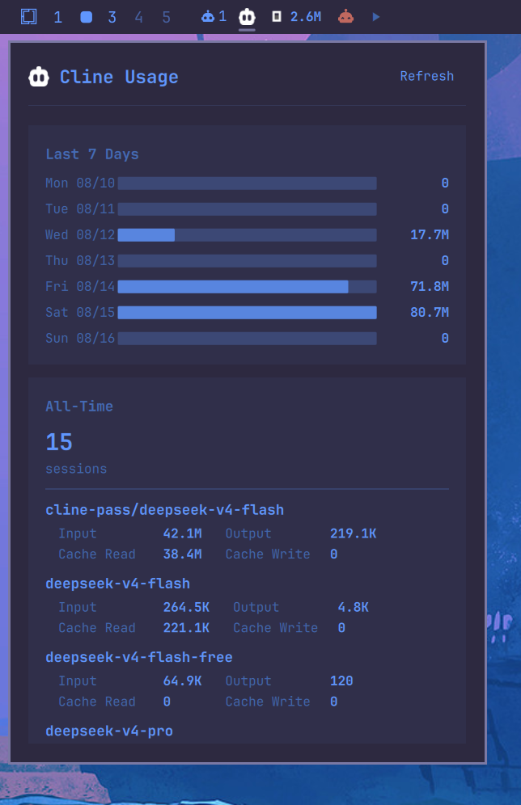

# dizziee.cline-model-usage

Cline token usage stats in the Omarchy bar. Displays today, weekly, and all-time token counts per model.

## Requirements

- Python 3
- Cline (official) https://github.com/cline/cline
  - AUR: `yay -S cline-cli`
- Cline with existing session data in `~/.cline/data/db/sessions.db`

## Installation

```sh
omarchy plugin add https://github.com/JJDizz1L/dizziee.cline-model-usage.git --enable
```

### Then place it in your bar layout with

`omarchy bar put dizziee.cline-model-usage [--section <left|center|right>]`

Suggested placement:

```
omarchy bar put dizziee.cline-model-usage --section left
```

You can validate the plugin at any time with:

```sh
omarchy plugin validate ~/.config/omarchy/plugins/dizziee.cline-model-usage
```

## Updating

To pull the latest version of the plugin:

```sh
omarchy plugin update dizziee.cline-model-usage --yes
```

## Configuration

Configuration lives in `~/.config/omarchy/shell.json`. The supported way to change it is:

```sh
omarchy bar set dizziee.cline-model-usage refreshIntervalSec 900 --json
```

| Key | Type | Default | Description |
|---|---|---|---|
| `refreshIntervalSec` | integer (30–3600) | 900 | How often the background scan may run (seconds) |

Numbers need `--json`, or they land in `shell.json` as strings. The panel's settings view (right-click the bar icon) writes the same value.

A background tick only starts Python when the cached snapshot is older than 90% of the interval. Opening the panel refreshes only if the snapshot is more than 30 seconds old; `r`, the Refresh button, or middle-clicking the bar icon forces a scan.

## Data and cache

The scanner opens Cline's SQLite database read-only and extracts only the model and token fields it needs for aggregate counts. Day attribution reads the per-message files Cline keeps beside the database, using only their `metrics` and `modelInfo` fields. It never copies the database, and message text is never stored or shown.

The last successful result is cached at `~/.cache/omarchy/dizziee.cline-model-usage.json`. That file is the compact aggregate the panel draws — currently about 4 KB, hard-capped at 128 KB — never messages or a database copy. The cache lets the bar paint immediately at shell start without spawning Python, and every bar instance watches it so one scan reaches every monitor. A failed scan leaves the cache and the displayed numbers alone and starts retrying after 30 seconds, backing off to five minutes; the panel marks the numbers stale and shows the last good result.

No network access is used.

## Translations

Every UI string comes from `i18n/en.json` through `Commons.Translations`, so the panel, bar tooltip, settings view, and error states follow the language picked under **Setup → Language** without a shell restart. Counts use `Commons.I18n.formatNumber` and weekday names use the language's locale.

To add a language, copy `i18n/en.json` to `i18n/<code>.json` (for example `da.json`, `pt-BR.json`) and translate the values. Keep the keys and the `%1`/`%2` placeholders unchanged. A missing key falls back to the base language (`pt-BR` to `pt`), then to English, then to the key itself, so a partial catalog is safe. Strings that count use CLDR plural forms:

```json
"cline.moreModels": {
  "one": "+%1 more model",
  "other": "+%1 more models"
}
```

Raw scanner diagnostics stay in English as technical detail; the surrounding status text is translated.

## IPC

```sh
omarchy-shell dizziee.cline-model-usage open
omarchy-shell dizziee.cline-model-usage close
omarchy-shell dizziee.cline-model-usage toggle
omarchy-shell dizziee.cline-model-usage refresh
omarchy-shell dizziee.cline-model-usage settings
```

## Preview



## Uninstall

```sh
omarchy plugin remove dizziee.cline-model-usage
rm -f ~/.cache/omarchy/dizziee.cline-model-usage.json
```

## License

MIT
